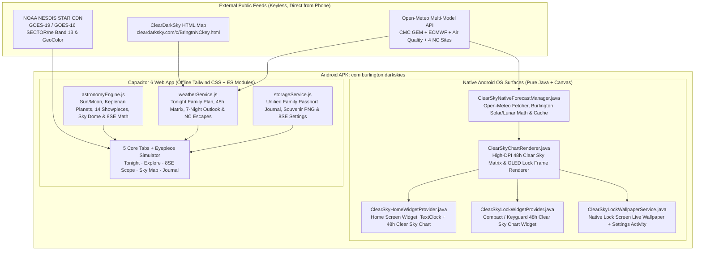

# Burlington Dark Skies — Project Handoff, Architecture & Session Specification

> **Purpose of This Document:** This specification provides complete technical, architectural, optical, and historical context so any future conversation or developer can immediately understand, maintain, extend, and recompile **Burlington Dark Skies** without prior context.

---

## 1. Executive Project Description

**Burlington Dark Skies** (`com.burlington.darkskies`) is a standalone, serverless **Android mobile application** ([Burlington-Dark-Skies.apk](file:///d:/MyProjects/Dark%20Skies/Burlington-Dark-Skies.apk)) purpose-built for **family stargazing and backyard space exploration** in **Burlington, North Carolina** (`Bortle Class 4`) using a **Celestron NexStar 8SE** (`8" f/10` Schmidt-Cassegrain) telescope.

### Key Capabilities
1. **Daytime-Aware Tonight Verdict & 7-Night Family Outlook (`Tonight` Tab):** Combines ClearDarkSky (`BrlngtnNC`) HTML scraping with **Open-Meteo Multi-Model** (`CMC GEM Seamless` + `ECMWF IFS 0.25°` + `Air Quality`) into an honest, plain-English **Tonight's Family Window** verdict (Dusk – 10:30 PM comfort advice, 8SE outdoor setup timing, Moon phase impact, streamlined 6-row 48-hour Clear Dark Sky matrix, and a live 7-night evening stargazing outlook).
2. **Interactive Overhead Burlington Sky Dome & 14 Family Showpieces (`Explore` Tab):** Projects 8 recognizable constellations (`Big Dipper`, `Cassiopeia`, `Orion`, `Cygnus`, `Lyra`, `Taurus`, `Leo`, `Pegasus`), Polaris, Moon, and **14 curated NexStar 8SE showpiece targets** onto a live overhead `<canvas>` sky dome with an evening rotation slider, honest tree-line altitudes, *"Tell the Family"* space stories, and 1-tap eyepiece setup tips.
3. **Celestron NexStar 8SE Cooldown, Dew Guard, SkyAlign & Canvas Eyepiece Simulator (`8SE Scope` Tab + `'fov'`):** Tracks real timestamp-persisted closed-tube 8" mirror cooldown (`Wide-Field 81x Ready` vs `Planetary 200x Crisp`), Carolina humidity & front-corrector dew margin, an overhead **3-Star SkyAlign Triangle Compass** (`22°–72°` backyard sightline solver + *UP + RIGHT* anti-backlash hand-control reminder), and a high-DPI `<canvas>` **Eyepiece Simulator** (`32mm`, `25mm Stock`, `12mm`, `9mm` + `f/6.3 Reducer` / `2x Barlow`) with live Galilean moons and real Saturn ring tilt.
4. **NOAA GOES-East Cloud Radar & "Worth the Drive?" NC Dark-Sky Escapes (`Sky Map` Tab):** Locks NOAA GOES-East (`SECTOR/ne`) Infrared & GeoColor satellite imagery dead-center on Burlington (`21.5%, 77.2%`) alongside live evening cloud & Bortle comparisons for **Cane Creek Mountains** (`20 min`), **Haw River State Park** (`25 min`), **Jordan Lake** (`42 min · Bortle 3`), and **Staunton River IDA Dark Sky Park** (`75 min · Bortle 2`).
5. **Family Celestial Passport & Sighting Journal (`Journal` Tab):** Tracks `X / 14 Cosmic Wonders Spotted` stamps, 5-star *"Family Wow"* ratings, 10-second sighting logging, an optional circular eyepiece sketchpad, and 1-tap **Souvenir Card PNG** sharing.
6. **Genuine Native Android Home Screen Widget & Lock Screen Live Wallpaper (`android/app/src/main/java/com/burlington/darkskies/`):**
   - **Home Screen Widget (`ClearSkyHomeWidgetProvider`):** Real Android `AppWidgetProvider` rendering a live OS `<TextClock>` Digital Clock + high-DPI 48-hour Burlington Clear Sky Chart (`Clouds`, `Clarity`, `Steady`, `Dark`, `Temp`), dynamically sized to the user's launcher grid without fake in-app mockups.
   - **Compact / Keyguard Lock Widget (`ClearSkyLockWidgetProvider`):** Compact 24-hour Clear Sky Chart widget (`home_screen|keyguard`) with larger 3-hour time markers designed to sit directly beneath an existing clock on Lock Screens or Home Screens.
   - **Lock Screen Live Wallpaper (`ClearSkyLockWallpaperService` + `LockWallpaperSettingsActivity`):** Real Android `WallpaperService` (`BIND_WALLPAPER`) applied directly to the Android **Lock screen**, drawing an OLED starfield and a dedicated **24-hour Clear Sky Chart** card (wider hour blocks + larger 3-hour time markers) cleanly underneath the phone's required system Lock Screen clock, with `0%` CPU drain while the screen is off.
   - **Launcher Icon Shortcuts (`NativeSkyShortcutActivity` + `res/xml/shortcuts.xml`):** Long-pressing the **Burlington Dark Skies** app icon on the Android Home Screen offers 1-tap OS shortcuts (**Set Lock Screen** and **Pin Sky Widget**).

---

## 2. Architecture & Refactoring Summary

### 2.1 High-Level Architecture Diagram



### 2.2 Functional Bug Fixes & Bloat Removal Log
1. **Offline Build-Time Tailwind CSS:** Replaced the runtime `cdn.tailwindcss.com` `<script>` (`~350KB`, which broke styling when offline at rural dark-sky sites) with build-time PostCSS + `tailwindcss@3.4.17` (`~6KB` gzipped CSS baked directly into the APK).
2. **Fixed Daytime `"EXCELLENT OBSERVING / Milky Way visible"` Bug:** Replaced hour-0 daytime rating logic with `computeTonightPlan()`, which evaluates Tonight's upcoming evening stargazing window (`Dusk – 10:30 PM`) while clearly labeling daytime status vs. live nighttime sky.
3. **Fixed Fake Altitude & Static Planet Coordinates Bug:** Eliminated hardcoded RA/Dec for Jupiter/Saturn and removed `Math.abs(alt) + 34` fake horizon math in `fovSimulatorScreen.js`. Added a full Keplerian planetary solver (`Venus`, `Mars`, `Jupiter` + live Galilean moons, `Saturn` + real sub-Earth ring tilt) in [astronomyEngine.js](file:///d:/MyProjects/Dark%20Skies/src/services/astronomyEngine.js).
4. **Fixed `dashboardScreen.js` Scrub Crash & Nearby Sites `undefined` Bug:** Fixed `.target_list` destructuring in the hourly inspector and unified the `NEARBY_NC_SITES` schema across `weatherService.js`, `dashboardScreen.js`, and `satelliteMapScreen.js`.
5. **Unified Split-Brain Logbook Storage:** Consolidated `dark_skies_burlington_logs_v1` and `burlington_obs_logs_v1` into a single canonical schema in [storageService.js](file:///d:/MyProjects/Dark%20Skies/src/services/storageService.js) (with automatic one-time migration).
6. **Removed Superfluous Prototype Clutter & Added Genuine Native OS Surfaces:** Deleted fake in-app `lockscreenWidgetScreen.js` and `alertsScreen.js`, fake phone status bars, and `RECORD_AUDIO`, and implemented real Android OS `AppWidgetProvider` Home/Keyguard widgets and a real `WallpaperService` Lock Screen Live Wallpaper in native Java.

---

## 3. Native Widget & Lock Screen Usage Guide (Android)

After installing [Burlington-Dark-Skies.apk](file:///d:/MyProjects/Dark%20Skies/Burlington-Dark-Skies.apk) on your Android phone:

### Adding the Home Screen Widget (Digital Clock + 48h Clear Sky Chart)
* **Method A (Standard Launcher):** Long-press an empty spot on your Home Screen → tap **Widgets** → scroll to **Burlington Dark Skies** → drag **48h Clear Sky & Digital Clock** (`4×2`, resizable) onto your Home Screen.
* **Method B (1-Tap App Icon Shortcut):** Long-press the **Burlington Dark Skies** app icon → tap **Pin Sky Widget**.

### Setting the Lock Screen (48h Clear Sky Chart Beneath System Clock)
* **Method A (1-Tap App Icon Shortcut — Fastest):** Long-press the **Burlington Dark Skies** app icon → tap **Set Lock Screen** → tap **Set wallpaper** → select **Lock screen** (tap the **Settings** gear in the preview to fine-tune vertical placement beneath your system clock / above your fingerprint sensor, or enable Auto Red Night Mode).
* **Method B (System Wallpaper Settings):** Open Android **Settings → Wallpaper & style → Change wallpapers → Live wallpapers** → select **Burlington Clear Sky Lock Screen** → apply to **Lock screen**.

---

## 4. Build, Simulator & APK Compilation Guide

### 4.1 Installed Local Toolchain Paths (Windows)
* **`JAVA_HOME`:** `C:\Users\smith\.android-build\jdk`
* **`ANDROID_HOME` / `ANDROID_SDK_ROOT`:** `C:\Users\smith\.android-build\sdk`

### 4.2 Live Desktop Phone Preview
```powershell
cd "d:\MyProjects\Dark Skies"
npx vite --port 5173 --host
Start-Process "msedge.exe" -ArgumentList "--app=http://localhost:5173", "--window-size=430,932"
```

### 4.3 Full Production Bundle & Android `.apk` Rebuild
```powershell
$env:JAVA_HOME = "C:\Users\smith\.android-build\jdk"
$env:ANDROID_HOME = "C:\Users\smith\.android-build\sdk"
$env:ANDROID_SDK_ROOT = "C:\Users\smith\.android-build\sdk"
$env:PATH = "$env:JAVA_HOME\bin;$env:ANDROID_HOME\cmdline-tools\latest\bin;$env:ANDROID_HOME\platform-tools;$env:PATH"

cd "d:\MyProjects\Dark Skies"
npm run build
npx cap sync android
Push-Location android
.\gradlew.bat assembleDebug
Pop-Location
Copy-Item -Path "android\app\build\outputs\apk\debug\app-debug.apk" -Destination "Burlington-Dark-Skies.apk" -Force
```
