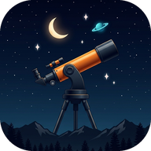

# Burlington Dark Skies

<p align="center">
  
</p>

A standalone, serverless **Android stargazing companion, Home Screen Widget, and OLED Lock Screen** built for backyard family space exploration in **Burlington, North Carolina** (`36.096°N, -79.438°W · Bortle Class 4`) with a **Celestron NexStar 8SE** (`8" f/10` Schmidt-Cassegrain).

---

## Features

* **Tonight's Family Verdict & 7-Night Outlook (`Tonight`):** Blends ClearDarkSky (`BrlngtnNC`) and Open-Meteo Multi-Model (`CMC GEM` + `ECMWF IFS`) into a plain-English evening stargazing plan, comfort & 8SE outdoor setup advice, 48-hour Clear Sky matrix, and 7-night forecast.
* **Interactive Overhead Sky Dome & 14 Showpieces (`Explore`):** Live overhead Burlington `<canvas>` sky dome with 8 major constellations, Polaris, Moon, evening time slider, *"Tell the Family"* space stories, and 1-tap eyepiece setup tips.
* **Celestron NexStar 8SE Optics & Eyepiece Simulator (`8SE Scope`):** Closed-tube 8" mirror thermal cooldown timer, Carolina dew-shield margin, overhead **3-Star SkyAlign Triangle Compass**, and a high-DPI `<canvas>` **Eyepiece Simulator** (`32mm`, `25mm`, `12mm`, `9mm` + `f/6.3 Reducer` / `2x Barlow`) with live Galilean moons and real Saturn ring tilt.
* **NOAA GOES-East Cloud Radar & NC Dark-Sky Escapes (`Sky Map`):** Live GOES-East Infrared & GeoColor satellite loop locked on Burlington alongside *"Worth the Drive?"* evening cloud & Bortle comparisons for **Cane Creek Mountains**, **Haw River State Park**, **Jordan Lake**, and **Staunton River IDA Dark Sky Park**.
* **Family Celestial Passport (`Journal`):** Tracks `X / 14 Cosmic Wonders Spotted` stamps, 5-star *"Family Wow"* ratings, optional eyepiece sketches, and 1-tap **Souvenir Card PNG** sharing.
* **Native Android Home Screen Widget & Lock Screen:**
  * **Home Screen Widget (`ClearSkyHomeWidgetProvider`):** Native Android `<TextClock>` digital clock + 48-hour Burlington Clear Sky Chart (`Clouds`, `Clarity`, `Steady`, `Dark`, `Temp`).
  * **Lock Screen Live Wallpaper (`ClearSkyLockWallpaperService`):** OLED deep-space starfield + 24-hour Clear Sky Chart with high-visibility 3-hour time markers positioned cleanly beneath your phone's system Lock Screen clock (`0%` idle CPU while screen is off, plus Eye-Safe Red Night Mode).

---

## Quick Install on Android

1. Download and install **[`Burlington-Dark-Skies.apk`](./Burlington-Dark-Skies.apk)** on your Android phone.
2. **Add the Home Screen Widget:** Long-press your Home Screen → **Widgets** → **Burlington Dark Skies** → drag **48h Clear Sky & Digital Clock** onto your screen *(or long-press the app icon → **Pin Sky Widget**)*.
3. **Set the Lock Screen:** Long-press the **Burlington Dark Skies** app icon → tap **Set Lock Screen** → **Set wallpaper** → **Lock screen** *(tap **Settings** in the preview to adjust vertical position or enable Auto Eye-Safe Red Mode at night)*.

---

## Local Development & Building from Source

### Web Preview
```bash
npm install
npm run dev
```

### Android APK Build
Requires JDK 17+ (`JAVA_HOME`) and Android SDK (`ANDROID_HOME`, `compileSdk 34`):
```bash
npm run build
npx cap sync android
cd android && ./gradlew assembleDebug
```

See **[`PROJECT_HANDOFF.md`](./PROJECT_HANDOFF.md)** for full architectural details.
